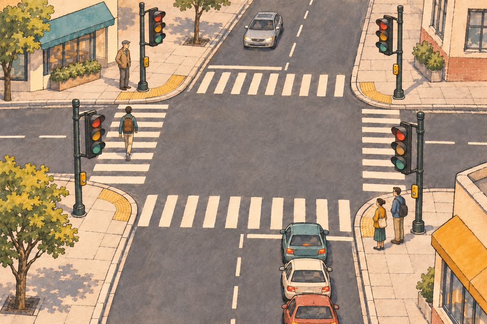
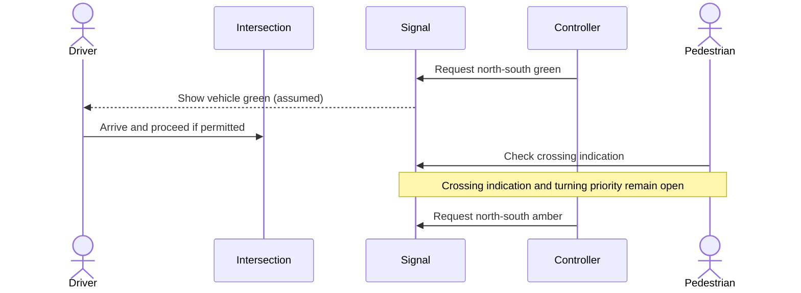
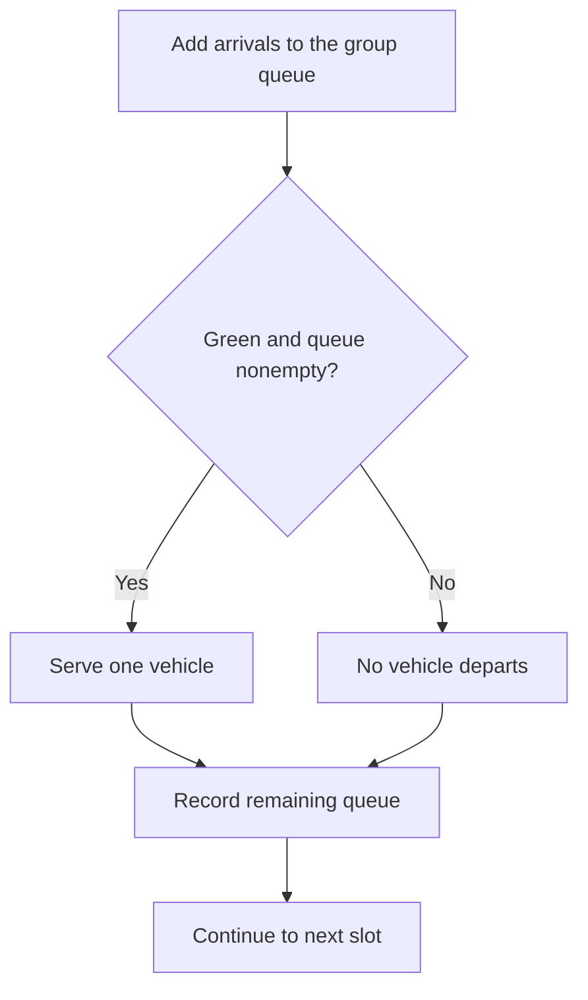

<span id="introducing-the-engineering-challenge"></span>

# Setting Up the Intersection Workshop

Imagine joining a city workshop about a busy four-way intersection. Drivers describe queues that build when cars arrive in bursts. Someone who walks there every day asks whether clearing those queues faster would make the street harder to cross. What would you want to learn before changing the signals?

<figure class="intersection-overview">



<figcaption>If the lead car turns left, its driver and the person on the crosswalk need to know whose turn it is to move.</figcaption>
</figure>

<span id="how-the-example-develops-through-the-course"></span>This fictional intersection is our shared case for the course. We will return to it as the work moves from a first model to deciding what evidence the city would need before making a change at the roadside.

> **Explore further**
>
> The [intersection scope](../../REFERENCE-INTERSECTION.md#the-shared-engineering-question) sets out the city's question and the people, movements and equipment it concerns. The [teaching sources](../../case-study/README.md) let you inspect the invented arrival patterns and follow the vehicle counts recorded at each model step.

## Start with engineering intent

<span id="start-with-outcomes-not-a-favored-solution"></span>The city's **engineering intent** is to improve traffic flow while protecting people crossing the road. A different signal sequence, new detectors and adaptive control are all possible ways to pursue that intent. To understand what a change would have to achieve, listen to the questions around the table.

| Who is at the workshop? | What do they need to know? |
| --- | --- |
| Drivers | How many cars are still waiting after a green light? |
| Pedestrians | When can I start across, and could a turning car cross my path? |
| People with different mobility needs | Is there enough time and a usable route to reach the far curb? |
| Operators | How can we keep the intersection usable while a change is in progress? |
| Maintainers | If a signal looks wrong, can we tell what the controller requested and what the lamp actually showed? |

> **Concept**
>
> For drivers, reducing queues is the **intent**. Their **question** is how many cars are still waiting after a burst has had a chance to clear. A future **requirement** could call for fewer vehicles left waiting than under an agreed reference sequence, given the same arrivals and counting period. The city would need to agree on representative conditions and a separate criterion for people crossing.

The city's purpose is broad because the team has not yet agreed on all the conditions or trade-offs. In an agile approach, engineers work with the people affected while investigations and design choices reveal what a useful requirement needs to say. A queue requirement, for example, needs an identified approach, a counting period, reference conditions and a criterion for comparison. These are proposed details to agree with the city, not measurements already obtained.

## A system view in SysML

A traditional Systems Modeling Language (SysML) description can locate the parts before the team simulates behavior. This illustrative structural definition says that an intersection contains a controller, vehicle signals and crossings. The controller sends commands to the signals; drivers and people crossing respond to indications. The definition is a starting point for discussion, not evidence that equipment is installed or safe.

```sysml
part def Intersection {
    part controller : Controller;
    part vehicleSignals : VehicleSignals;
    part crossings : Crossings;
}
part def Controller;
part def VehicleSignals;
part def Crossings;
```

The text names the `controller` part and its type. A [structural view in Chapter 4](04-engineering-knowledge-as-code.md#one-source-several-useful-perspectives) uses the same definition. It does not yet specify crossing indications, turning priority or the physical connections.

## Describe traffic flow

Traffic-flow information answers a different question: how many vehicles arrive at each approach, and when? The same total can arrive steadily or in a burst. Before combining a count with the system description, someone must identify which modeled approach it describes and the interval it covers.

For example, an invented count might record three arrivals on the north arm from 8:00 to 8:05. To use it with the two-group model, the team would relate that arm to the north–south group and combine it with the corresponding south-arm count. If the interval spans a phase change, the total alone cannot show whether the vehicles arrived before or after green ended. The team would need timestamps or counts grouped by phase. The current model cannot recover a north-arm count from its combined group. Its abstract slots are not those five minutes.

For the first illustrative comparison, the team groups traffic north–south (NS) and east–west (EW), starts both queues empty and uses eight abstract slots, not seconds. Its fixed phase sequence, arrival counts and service rules are maintained in the [T1 inputs](../../case-study/model-inputs-v1.json). The table is generated from those inputs: both invented scenarios contain two NS and two EW arrivals, placed at different times.

<!-- interactive: arrival-patterns -->

## Two views maintained as text

The following sequence shows one illustrative ordering of controller, signal and road-user interactions. The controller requests north–south green, the signal shows it, a driver arrives and proceeds if permitted, and a pedestrian checks the crossing indication. The controller then requests amber. The displayed indication and driver response are assumptions for this discussion; the queue model does not simulate a signal head or a pedestrian crossing. It has no rule for when a pedestrian may cross or a turning vehicle may proceed.



The flowchart focuses on the vehicle queue in one slot. Arrivals join first. If the group's phase is green and the queue is nonempty, one vehicle leaves; otherwise no vehicle departs. The remaining queue is recorded before the next slot. It does not represent the crossing shown in the sequence.



A conventional image handoff can make the picture easy to read, but someone must also find the definition and check its revision before changing it. These Mermaid definitions are readable, versioned text rendered as diagrams. An AI agent could read them with the other shared information and propose, for example, a note identifying a newly specified crossing indication. An engineer would compare the proposed text and rendered view with the agreed system description before accepting it. [Chapter 4](04-engineering-knowledge-as-code.md) develops that shared-information practice.

## A prototype for the first question

<span id="the-first-learning-question"></span>The drivers' accounts suggest a hypothesis about *when* cars arrive. Imagine that two patterns bring the same number of vehicles to each road over the same period. If the signals follow the same sequence, could the timing of the arrivals alone change how many vehicles are still waiting at the end?

<span id="establish-a-whole-system-boundary"></span>We can explore that question with a prototype small enough to follow on paper. Give north–south traffic one queue and east–west traffic another. Start both empty. At each model step, invented arrivals join their queue and the fixed signal phase determines whether one vehicle can leave. Record how many are still waiting after each step.

<span id="two-kinds-of-work-follow-from-the-same-question"></span>An engineer who rarely writes simulations can describe those rules to an AI assistant and ask for a runnable draft. Following one vehicle through a step by hand gives the engineer a way to check the draft and correct a mistaken assumption. Keeping the rules and inputs together lets a colleague move a burst and run the comparison again. If the final count hides a queue that formed and cleared earlier, they can go back to the count for each step.

<span id="what-the-example-willand-will-notprove"></span>That prototype covers vehicle arrivals, signal phases and queues. On the street, the controller, its electrical connections and the signal heads must work together to show people when they may move. Can someone reach the far curb before a turning car is allowed across the same path? To investigate that, the team needs the crossing distance, the indications people actually see and observations of how people use the crossing.

<!-- interactive: chapter-quiz -->

## Choosing the first increment

<span id="the-next-decision"></span><span id="from-the-first-question-to-the-next-experiment"></span>The team could spend its first increment comparing arrival patterns or mapping where turning vehicles and pedestrians share a path. Which uncertainty matters more to the city's next decision? Carry your choice into [Chapter 3, Planning Under Uncertainty](03-planning-under-uncertainty.md).
